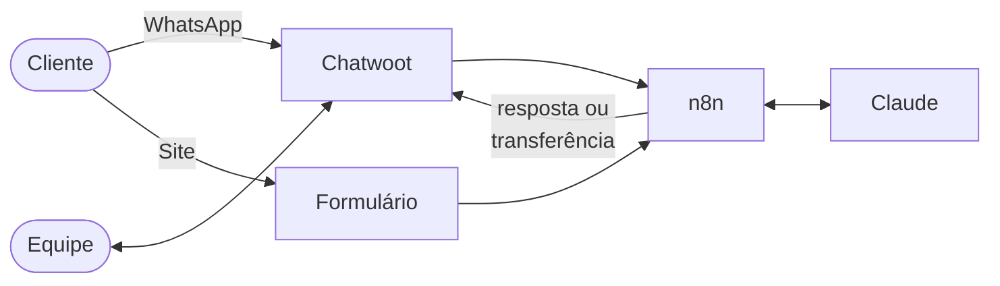

# Maluvia

[](https://github.com/eduardo-martins-tech/maluvia/actions/workflows/testes.yml)


Sistema de uma loja virtual de moda feminina (roupas e semijoias), construído por módulos sobre a mesma infraestrutura e o mesmo banco de dados.

| Módulo | Status |
|---|---|
| **Atendimento com IA** — `atendimento/` | v0.1.0 |
| Base de dados da loja (pedidos, clientes, estoque) | planejado |
| App de gestão para as sócias | planejado |
| Rotinas automáticas | planejado |
| Análises de vendas | planejado |

## Atendimento com IA

**Malu** é a atendente virtual da loja: responde clientes pelo **WhatsApp** e pelo **Fale Conosco do site**, consulta pedidos e passa a conversa para uma atendente humana quando precisa, **na mesma conversa e pelo número da loja**.

> Projeto real em desenvolvimento. Este repositório usa **dados fictícios** (regras da loja, pedidos e clientes) e o número de teste da Meta.

### O problema

Uma loja virtual pequena recebe as mesmas perguntas o dia todo: qual tamanho usar, quanto custa o frete, onde está o pedido, como trocar. Responder tudo à mão toma o tempo das sócias, e fora do horário a cliente fica sem resposta, muitas vezes desistindo da compra.

Ao mesmo tempo, uma reclamação ou um produto com defeito não pode ficar nas mãos de um robô.

### A solução



- **A IA responde na hora, 24 horas**, usando só a base de conhecimento da loja e os dados do pedido. Ela não inventa prazos nem promete reembolso.
- **Ela sabe quando parar.** Reclamação, defeito, reembolso, cliente pedindo uma pessoa ou duas respostas sem resolver: a IA avisa a cliente, deixa um resumo para a equipe e entrega a conversa.
- **A equipe assume no mesmo lugar.** Pelo Chatwoot, no navegador ou no celular, vendo tudo o que a IA já respondeu, e responde pelo número da loja.
- **Tudo é medido.** Um relatório mostra a taxa de resolução pela IA, os assuntos mais comuns e os motivos de transferência.

Detalhes em [docs/arquitetura.md](docs/arquitetura.md).

### Destaques técnicos

- **Estado da conversa no Chatwoot:** a IA atua como bot de agente. Conversa *Pendente* é da IA; *Aberta*, da equipe. Não há regra de tempo nem flag duplicada para sincronizar.
- **Resposta estruturada:** a IA devolve JSON (`categoria`, `resposta`, `transferir`, `resolvido`), o que permite aplicar regras em código e gerar indicadores.
- **Rede de segurança determinística:** palavras-chave e um limite de tentativas forçam a transferência, independentemente do julgamento da IA.
- **Código do fluxo versionado e testado:** o JavaScript dos nós fica em `atendimento/src/`, um script gera o fluxo importável e um simulador roda 13 cenários de conversa. O GitHub Actions confere tudo a cada push.
- **Infraestrutura em um comando:** Docker Compose com n8n, Chatwoot, Postgres e Redis, com túnel para desenvolver no computador e HTTPS automático na VPS.
- **Custo de operação de cerca de R$ 100 por mês** ([docs/custos.md](docs/custos.md)).

### Resultados

| Indicador | Antes | Depois |
|---|---|---|
| Tempo até a primeira resposta | a medir | a medir |
| Atendimentos resolvidos sem a equipe | — | a medir |
| Mensagens respondidas fora do horário | — | a medir |

Os números serão preenchidos com os dados do relatório depois da implantação.

## Stack

n8n · Chatwoot · WhatsApp Cloud API (Meta) · Claude Haiku (Anthropic) · Docker Compose · Postgres · Redis · Caddy · ngrok · GitHub Actions

## Estrutura

```
├── atendimento/
│   ├── base-conhecimento.md      regras da loja usadas pela IA
│   ├── src/                      código de cada nó do fluxo
│   ├── scripts/montar_workflow.py  gera o fluxo a partir de src/
│   ├── testes/simular.js         simulador de conversas
│   └── workflow/                 fluxo pronto para importar no n8n
├── infra/
│   ├── docker-compose.yml        n8n, Chatwoot, Postgres, Redis, túnel e proxy
│   ├── .env.example              configurações (copie para .env)
│   └── gerar-env.sh              cria o .env com senhas aleatórias
└── docs/                         arquitetura, setup, produção, custos e decisões
```

## Como rodar

- **No seu computador, de graça:** [docs/setup-local.md](docs/setup-local.md)
- **Em produção, numa VPS:** [docs/producao.md](docs/producao.md)

Testes, sem precisar de nenhum serviço:

```bash
python atendimento/scripts/montar_workflow.py
node atendimento/testes/simular.js
```

## Roadmap

1. **Atendimento com IA** — este repositório
2. Base de dados da loja: sincronização de pedidos, clientes e estoque com o site e o ERP
3. Consulta real de pedidos no atendimento
4. App de gestão para as sócias: vendas, pedidos, estoque, financeiro e clientes
5. Rotinas automáticas: resumo da manhã, pedidos parados, grade acabando e conferência de recebimentos
6. Análises: funil do site, canais, grupos de clientes, peças que vendem juntas, grade ideal e previsão de vendas

As decisões técnicas estão registradas em [docs/decisoes.md](docs/decisoes.md), as mudanças de cada versão no [CHANGELOG](CHANGELOG.md) e o jeito de trabalhar no repositório em [docs/fluxo-de-trabalho.md](docs/fluxo-de-trabalho.md).

## Como foi desenvolvido

A estrutura inicial (v0.1.0) foi construída com assistência de IA (Claude, da Anthropic). Definição do problema, arquitetura, escolhas técnicas, configuração, implantação e ajustes com a cliente são meus. As contribuições seguintes estão no histórico de commits e nos pull requests.

## Licença

[MIT](LICENSE). Os dados da loja neste repositório são fictícios.

## Autor

**Eduardo Martins** — [GitHub](https://github.com/eduardo-martins-tech) · [LinkedIn](https://www.linkedin.com/in/seu-perfil) · [Portfólio](https://seu-site.com)
