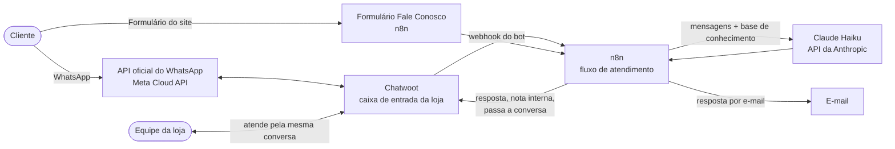
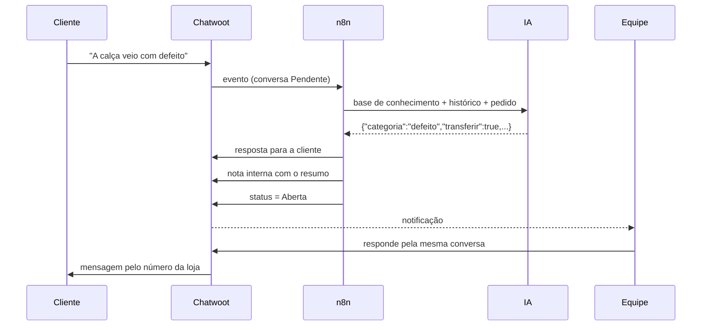

# Arquitetura

## Visão geral

Tudo roda numa única máquina com Docker (`infra/docker-compose.yml`): Postgres, Redis, Chatwoot (web e worker), n8n e, conforme o ambiente, o túnel (ngrok, no computador) ou o proxy com HTTPS (Caddy, na VPS).

O n8n e o Chatwoot conversam pela rede interna do Docker (`http://rails:3000` e `http://n8n:5678`). Só o Chatwoot precisa de endereço público, porque é ele quem recebe os eventos da Meta.

## Quem atende: a IA ou a equipe

O Chatwoot é a fonte da verdade. A IA está ligada à caixa de entrada como **bot de agente**:

- Conversa **Pendente** → pertence ao bot. Cada mensagem da cliente gera um evento para o n8n.
- Conversa **Aberta** → pertence à equipe. O n8n ignora os eventos dela.
- Conversa **Resolvida** → se a cliente escrever de novo, volta como Pendente, para o bot.

## O fluxo no n8n

| Nó | O que faz |
|---|---|
| Chatwoot: nova mensagem | Recebe os eventos do bot |
| Formulário Fale Conosco | Formulário público gerado pelo n8n |
| Normalizar Chatwoot / formulário | Converte as duas entradas num formato único; descarta o que não é mensagem da cliente com o bot |
| Base de conhecimento | Regras da loja (gerado de `atendimento/base-conhecimento.md`) |
| Montar contexto | Histórico da conversa, pedido citado, gatilhos de transferência e o prompt da IA |
| IA (Claude) | Chamada à API; a IA responde em JSON |
| Aplicar regras e registrar | Valida o JSON, aplica as regras de transferência, guarda histórico e registro |
| Responder no Chatwoot / por e-mail | Entrega a resposta pelo canal de origem |
| Nota interna + Passar conversa | Na transferência: resumo para a equipe e status Aberta |
| Avisar equipe por e-mail | Transferência vinda do formulário |
| Relatório (link) | Indicadores do atendimento, protegidos por chave |

## Regras de transferência

A conversa vai para a equipe quando **qualquer** condição acontece:

1. A IA marca `transferir: true` (reclamação, defeito, reembolso, atraso, pergunta fora da base…).
2. A mensagem tem uma palavra-chave (atendente, defeito, reembolso, estorno, cancelar, Procon, absurdo…). É uma rede de segurança: não depende do julgamento da IA.
3. Duas respostas seguidas sem resolver.
4. A resposta da IA veio fora do formato esperado.

## Onde ficam os dados

| Dado | Onde | Observação |
|---|---|---|
| Conversas completas | Chatwoot (Postgres) | Fonte oficial do histórico |
| Histórico curto para a IA e registro de atendimentos | Dados estáticos do fluxo no n8n | Simples para a primeira versão; migra para uma tabela no Postgres quando houver o app de gestão |
| Pedidos | Fictícios, em `montar_contexto.js` | Substituídos pela consulta ao ERP/plataforma da loja |

## Código-fonte do fluxo

O JavaScript de cada nó fica em `atendimento/src/`, onde dá para ler, revisar e testar. O script `atendimento/scripts/montar_workflow.py` monta o JSON importável em `atendimento/workflow/`. O GitHub Actions confere se o JSON está atualizado e roda os testes a cada push.
